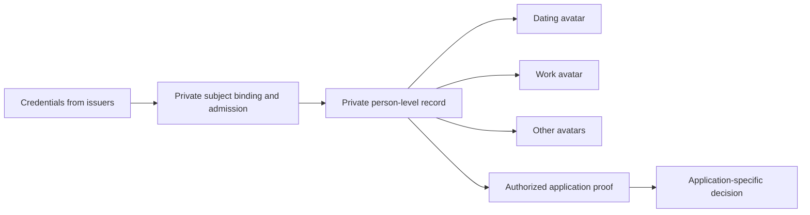

# Design patterns for attestations, reputation, and private identity

**Author:** Jamie Zigelbaum (tracheopteryx)  
**Status:** Discussion draft for review, 14 October 2026 — revision 3 (credentials and the private storehouse)

A reputation system should let people learn whom to trust without requiring everyone to publish their entire lives, accept one universal score, or use the same decision rules.

That calls for several separations: a claim from its interpretation, skill from trust, reputation from authority, an avatar from its underlying identity, and a private conversation from an enforceable promise.

This document collects general design patterns for making those separations explicit. They can be adopted independently. Some are compatible alternatives, while others require choosing a policy or resolving a trade-off. They do not prescribe a particular chain, asset, scoring algorithm, identity provider, or cryptographic implementation.

The organizing model is:

**Claims and records → authorized evidence or proofs → competing interpretations → application-specific decisions.**

Privacy applies across the whole model. Shared standards do not require shared visibility.

## 1. Distinguish the things people attest to

An **attestation** is an attributable statement about something. A signature can establish that a key authorized the statement. It does not establish that the statement is true, that its subject is a unique human, or that its author is competent to judge it.

Useful categories include:

| Kind | Example | What it contributes |
| --- | --- | --- |
| Factual self-claim | “I hold this qualification.” | A claim that may need independent evidence |
| Self-assessment | “I am skilled at security reviews.” | Discovery information, not independent endorsement |
| Factual claim about another person | “I met this person in person.” | Evidence of a particular relationship or fact |
| Subjective endorsement | “I vouch for this person as a member of our group.” | A judgment scoped to a community and purpose |
| Evaluation of work | “This security review identified important vulnerabilities.” | Evidence about a contribution |
| Commitment | “I will deliver the review under these terms.” | An obligation concerning future conduct |
| Dispute | “This credential claim is false; here is my evidence.” | A challenge to another statement |

Keep two axes separate: **who or what the statement concerns**, and **whether it asserts a fact, expresses a judgment, or makes a promise**. An evaluation may concern a person, a work product, a decision, or another attestation. These are not interchangeable.

Schemas should preserve these distinctions so that applications can interpret the records appropriately.

### 1.1. Worked example: vouching for group membership

A central use case for trust graphs is people vouching for one another as members of a group. Consider a research collective in which Alice attests:

> “I vouch for Bob as a member of this collective: I trust him to participate in good faith and respect our shared norms.”

This is a **subjective endorsement**. It expresses Alice’s judgment of Bob in a particular community, not a fact about his universal trustworthiness or expertise. It can support admission, express continuing support for an existing member, or help constitute membership in an informal group.

Keep four statements distinct:

- **Acquaintance:** “I have worked with Bob.” A claim about a relationship that may inform a vouch.
- **Membership vouch:** “I support Bob’s membership in this collective.” Alice’s situated judgment.
- **Membership status:** “Bob currently satisfies this collective’s membership rule.” A claim checkable against the specified rule and its required evidence, where such a rule exists.
- **Delegated authority:** “Bob may admit members on my behalf.” A grant of power, not merely a favorable judgment.

A group might define membership through two current-member vouches, use a declared graph-based rule, or treat vouches as evidence for a separate admission decision. An informal group may have overlapping judgments of membership without a single authoritative roster. These are different ways to turn endorsements into social or institutional standing; the attestation schema should not silently choose one.

At minimum, preserve who vouches for whom, for which group, with what intended meaning, and when the vouch was made or withdrawn. A vouch for one community is not automatically a vouch for another, a guarantee of future conduct, or a promise to compensate for misconduct. Lack of vouches is not itself a negative endorsement: it may reflect unfamiliarity or exclusion from existing networks.

## 2. Separate trust, skill, and authority

**Skill** concerns capability in a domain. **Trust** concerns a willingness to rely on someone for a purpose, often including expectations about their alignment or conduct.

Someone may be an excellent engineer whom a community does not trust to represent its interests. Someone else may be deeply trusted but lack the expertise to review a bridge contract. A single score obscures that difference.

A useful pattern is to make skill information abundant while making allocations of decision-making influence explicit and bounded. A person can acknowledge another’s expertise without appointing them or delegating power to them.

Reputation is an input to institutional design, not a substitute for it. Applications still decide:

- which skills and relationships matter;
- whether endorsements support discovery, group membership, signaling, appointment, election, or delegated action;
- what authority a role carries, for how long, and subject to which checks; and
- how that authority can be challenged or withdrawn.

Different communities can act differently on the same evidence. A useful professional reputation need not confer governance power everywhere.

## 3. Give backing an explicit meaning

“Staking on someone” can describe several different mechanisms:

- **Allocating scarce influence:** assign part of a bounded endorsement budget.
- **Making identity abandonment costly:** lock resources behind a persistent identity.
- **Backing a prediction:** accept economic exposure to a judgment about future performance.
- **Bonding a promise:** place collateral behind a specific obligation.
- **Exposing reputation:** let future evidence affect the endorser’s own credibility.

These can coexist, but one does not imply the others. Allocated weight need not be slashable. A reputational loss is not a transfer of collateral. A bond behind delivery of a report does not make every judgment in that report objectively correct.

For each mechanism, specify whose resources are at risk, what they back, how long the exposure lasts, what constitutes failure, who can determine it, and how withdrawal or appeal works.

Conservation matters where backing is scarce. An identity, delegation chain, or private presentation must not let the same backing count more times than the application permits.

## 4. Separate disagreement, correction, and enforcement

A system needs more than one response to contested information:

1. **Disagreement:** another participant records a different judgment.
2. **Factual challenge:** someone identifies an allegedly false claim and supplies evidence.
3. **Correction or revocation:** an authorized party updates the status of a record.
4. **Economic enforcement:** a defined process applies a penalty for a specified fault or breach.

Disagreement with an endorsement is not, by itself, proof of misconduct. Judgments of competence or contribution can be evaluated over time without pretending that every difference of opinion is a slashable offense.

Withdrawing a membership vouch changes the endorsement record. Whether that ends the subject’s membership depends on the group’s rules; revocation of a vouch and revocation of membership are distinct events, even when a policy links them.

Preserve authorship while allowing recipient protection. The attester can revoke their own statement; the subject can issue a separate dispute linked to it. Interpreters can account for both. A subject’s disagreement need not erase another person’s speech.

Acceptance-gating is another possible pattern: only statements a recipient accepts enter a particular relationship or scoring process. But it cannot also grant the recipient an unrestricted veto over valid adverse records needed for an application check. A borrower cannot opt out of an authenticated default record merely by declining it.

That requires explicit rules for admissibility, challenges, correction, and resolution. An arbitrary accusation is not an established default, and a pending dispute is not a final finding.

## 5. Keep a market of interpretation above the records

Store claims and their context separately from the scores or decisions derived from them.

Different analysts, curators, communities, and applications can choose different trust anchors, weighting rules, evidence policies, time horizons, and perspectives. A proof can establish that a declared rule was applied correctly. It does not establish that the rule is wise or that its output should carry authority.

Preserve enough information to distinguish at least:

- the underlying records or commitments to them;
- the evidence set authorized for the computation;
- the interpretation policy and its version;
- the resulting score, classification, or proved predicate; and
- the application decision made from it.

Privacy makes this separation more important. Interpreters may receive different evidence or only proofs of selected properties. They can still interoperate without seeing the same complete dataset.

A market of interpretation is compatible with mandatory input rules. A lender can require an honest answer about defaults while remaining free to decide how much that history matters. Interpretive freedom does not require allowing applicants to select a misleading input set.

## 6. Separate endorsement from delegated curation

“I endorse this person” is different from “I authorize this person to make endorsements on my behalf.”

An explicit curation relationship can pass an allocated share of influence to someone who maintains judgments about contributors. Ordinary endorsements need not propagate influence further.

If Alice vouches for Bob’s membership and Bob vouches for Carol, Alice has not thereby vouched for Carol or delegated her judgment to Bob. A group may deliberately use that path as indirect evidence, but the inference belongs to its interpretation policy, not to the meaning of Alice’s original statement.

Curators can combine work evaluations, credentials, fulfilled commitments, and other evidence. They can specialize by domain and compete on the usefulness of their judgment. People can change curators without recreating their entire identity or reputation history.

Transitivity is a separate choice. Possible designs include no propagation, one delegation hop, repeated explicit delegation, or broader graph inference. Each has different implications for cycles, concentration, allocation limits, and accountability.

Do not treat graph-derived reputation as identical to conserved delegated authority. Nor should an identity-splitting-sensitive weighting rule become safe merely because its inputs are signed. Quadratic allocation, for example, needs a defensible account of which allocations belong to the same person or principal.

## 7. Evaluate contributions, and then evaluate the evaluators

Endorsements express expectations. Evaluations assess what happened.

Evaluate work products and decisions separately from the overall standing of their creators. Where practical, anonymized review can reduce identity bias. Delayed-impact work needs an appropriate evaluation horizon rather than an immediate popularity contest.

Evaluations can update three different things: the contributor’s reputation, the credibility of their endorsers, and the reputation of the evaluators themselves. This last layer is **meta-reputation**: evidence about whose evaluations are useful under a declared standard.

Incentives should match the signal:

- Accurate skill discovery can justify rewards based on subsequent evidence.
- Trust or alignment endorsements may be more informative without direct payouts for expressing them.
- Curators can be rewarded for maintaining useful, current allocations.
- Rewarding growth in endorsements alone can reward popularity, circular reinforcement, or collusion instead of contribution.

No community must adopt one set of evaluators or one definition of value. The important requirement is to make the evaluation process legible enough to assess and contest.

## 8. Preserve context as schemas and judgments evolve

Domain-specific records carry more information than a universal rank. Tags, domain hierarchies, rationale, timing, and schema versions help preserve what a claim meant when it was made.

Keep raw inputs distinct from derived weight or expiry. An application may discount an old endorsement without requiring its author to recreate it every time an interpretation rule changes. Different schema versions can coexist if interpreters understand their differences.

Also distinguish:

- **Revocation:** the issuer withdraws a statement.
- **Expiry:** a credential or statement ceases to qualify under a declared rule.
- **Correction:** an error is amended with attributable provenance.
- **Reinterpretation:** unchanged evidence receives a different weight or meaning under a new policy.

Record lifecycle events must reach authorized consumers, including private ones. A correct result from an obsolete record or policy may no longer be acceptable for a new decision.

## 9. One private identity, many selective-disclosure avatars

For applications that require persistent human accountability, a useful design target is **one underlying identity and reputation storehouse per verifiable individual human, with many avatars over it**.

The storehouse can include credentials, reputation, relationships, commitments, and other linked records. It is a logical continuity requirement, not a demand for one physical database, public registry of everyone’s life, or global reputation score. Records can remain distributed while the relevant proofs establish their common subject and required coverage.

Human identity is also distinct from account control. Linking wallets proves neither unique humanity nor the truth of the claims made from them. Systems that admit organizations or software agents should identify those types separately rather than implicitly treating every key as a person.

### 9.1. Avatars are views, not clean slates

A person might maintain a professional identity, a pseudonymous contributor account, and a dating profile. Each can reveal a different subset of information or prove different properties of the same underlying record.

These are logical relationships, not necessarily publicly visible links. A presentation should avoid exposing a stable identifier that lets unrelated observers correlate the person’s avatars.

Creating another avatar is legitimate. Creating another supposedly unique human identity to escape an obligation, multiply an entitlement, or conceal relevant history is a different act. The system must prevent such duplicates from being accepted and define penalties for attempted evasion. The mechanism needs an account of detection, evidence, adjudication, and proportionate sanctions; neither cryptographic keys nor a proof system supply that by themselves.

### 9.2. Many credential issuers, one private storehouse

Within this pattern, **all person-related credentials and reputational records admitted to the system should bind to the same private person-level storehouse**, whether received directly or through an avatar. The avatar is an interface and a disclosure view, not a separate pool of history.

Consider a graduate-school diploma received through a professional avatar:

1. The university issues a credential asserting that a particular individual earned the qualification.
2. Admission verifies its provenance and its binding to the individual behind that avatar. Possessing a copy of a diploma, or controlling the receiving account, is not enough to establish that its holder is the graduate.
3. The credential, or a verifiable reference or commitment to it, becomes part of that individual’s private storehouse.
4. The professional avatar can disclose the diploma or prove a required qualification. A dating avatar can leave it undisclosed. Another avatar can use an authorized proof of the same qualification without exposing the connection between those avatars.

A credential issuer contributes a claim about a person; it need not create another underlying identity. A diploma, membership credential, and professional certification from different issuers can therefore converge on the same person-level record. Their issuer-specific identifiers need not become public identifiers, and the binding mechanism should not require issuers or verifiers to learn the person’s other avatars.

The proposed default is **private at admission, selectively disclosed or proved in use**—not public first and hidden later. The storehouse remains a logical record: this does not require copying every credential into one database or giving one operator access to all its plaintext.

Common attribution does not erase context. A vouch still concerns its specified group, and a qualification still concerns its specified field. Binding records to one person does not make every credential relevant to every application.

“All” refers to person-related records admitted under the system’s evidence rules, not every credential ever issued outside it or every unsolicited claim asserted about someone. Admission preserves authorship, scope, and disputed or revoked status; it does not make every statement true. Once admitted, hiding a record from an avatar must not remove it from a check whose evidence policy requires it.

### 9.3. Private in one context, checkable in another

Group membership provides a direct example. A person could prove that their private vouches satisfy a group’s declared membership rule without exposing their endorsers or unrelated affiliations to the verifier. Such a proof establishes satisfaction of the rule, not the objective truth of the endorsers’ judgments. Where the group requires one membership per person, using another avatar must not create another entitlement; enforcing that requires a separate uniqueness mechanism. Vouch withdrawal and membership-status changes also need to be reflected under the policy’s freshness rules.

A second example concerns adverse history. Consider a person who has defaulted on a loan:

1. Their dating profile does not display that history.
2. They use that avatar, or another avatar, to apply for a loan.
3. The lender requires an authorized check: **“Has this person defaulted on a loan?”**
4. A zero-knowledge-backed response returns **yes or no** without disclosing the prior lender, loan amount, transaction details, legal name, or other avatars, except for information separately required by the application.
5. The applicant cannot obtain a valid **no** by switching avatars, hiding the default from the profile, or omitting it from the required history.

The answer reveals the agreed fact. It does not reveal the records behind it. The person may decline the check, but then has not satisfied that lender’s condition. Failure to supply a proof is not itself proof of a default.

This is the central distinction: **privacy controls disclosure; profile curation must not permit falsification of a required check.**

### 9.4. A private proof needs an evidence policy

A correct computation over applicant-selected records can still mislead. The verifier needs a defined answer to these questions:

- **Subject:** does this check concern the person behind the applicant avatar?
- **Coverage:** which admitted records and issuing sources must be included for this check, regardless of which avatar received or presented them?
- **Status:** how are disputed, corrected, revoked, resolved, or expired records treated?
- **Freshness:** which checkpoint or time period does the answer cover?
- **Purpose:** who may ask this question, for which transaction, and with what permitted output?

A conceptual proof receipt binds the result to the subject-binding mechanism, evidence checkpoint, policy version, and intended use. It must not expose a universal subject identifier as the price of verification. Purpose-scoped replay or duplicate-use controls can help, but they do not establish unique humanity on their own.

A commitment to all admitted records can prevent omission after admission. It cannot prove that every real-world event was reported or that every issuer is honest. Evidence coverage and issuer policy are part of the claim being made, not details to hide behind the phrase “ZK verified.”

Credential diversity is therefore distinct from identity duplication. Many issuers can attach credentials to one private identity; a diploma does not itself establish that the individual has only one underlying storehouse. The remaining uniqueness obligation belongs to person-level enrollment, recovery, and any federation between identity systems: they must prevent the same person from operating separate accepted storehouses to evade a required check or multiply an entitlement. Shared subject-binding and continuity rules need not expose public cross-avatar links.

### 9.5. Persistence without permanent judgment

Persistent history must allow attributable corrections and status changes. It should not turn an accusation into an immutable fact or a past mistake into permanent exclusion.

Different lenders may interpret the same verified default differently. One might reject the application; another might consider the circumstances or offer different terms. A dating application need not ask the question at all.

Key recovery also matters. Replacing lost credentials must not create two active identities, erase enforceable obligations, or permit selective reconstruction of only favorable history. Legitimate recovery needs a different path from duplication or reputation reset.

Finally, query access is itself sensitive. Repeated yes/no questions can reconstruct private information. Restricting predicates, audiences, frequency, and purpose may matter as much as hiding the underlying records.

## 10. Separate private messaging, attestations, and commitments

Encrypted messaging can transport claims, proofs, requests, and promises. It should not silently turn every conversation into transferable evidence.

These are different questions:

- Can the recipient authenticate whom they are communicating with?
- Can the recipient prove authorship or content to a third party?
- Can an authorized verifier establish a property without reading the message?
- Does the message create an obligation with an agreed enforcement process?

An ordinary conversation may prioritize confidentiality and deniability. A credential may need portable verification. A commitment may require evidence that a designated adjudicator can inspect. Those choices should be deliberate and visible to the participants.

Encryption of content does not hide the communication graph, timing, identities of participants, or connections between avatars. Nor does a zero-knowledge proof hide its inputs from a prover that receives them in plaintext. Storage, computation, transport, and output disclosure each need their own confidentiality assumptions.

Private contestation adds another layer. Specify who can discover and challenge a claim, what an adjudicator can inspect, and how authorized applications learn of the outcome. Withdrawing future access cannot make a recipient forget already disclosed information.

### Commitments as a related primitive

A commitment makes a future obligation explicit and may attach backing, a counterparty, an adjudicator, release conditions, and a bounded penalty. It can produce evidence relevant to reputation: a promise was made, fulfilled, disputed, or found to have been breached.

That interface does not make every endorsement a promise, or every low rating a reason to seize collateral. A verified enforcement event also does not eliminate the need to understand the arbiter’s authority and the applicable terms.

The [commitments repository](https://github.com/AInima-Collective/commitments) is relevant here. Its public documentation describes stake-backed promises as parameterized liens, with bounded enforcement and a challenge window. It provides a concrete related model for obligations and economic exposure. Connecting those events to a private reputation system would still require identity binding, evidence-status rules, and an agreed disclosure policy.

## 11. Relationship to the trustgraphs work

These patterns are intended as a contribution to the design discussion, not a replacement for the repository’s accepted architecture or a claim about features it already provides.

The [trustgraphs overview](https://github.com/AInima-Collective/trustgraphs) describes a useful integrity property: score proofs are bound to a committed input set, so a prover cannot choose favorable attestations and omit the others. That addresses omission within the captured dataset. It does not by itself establish unique humans or complete real-world personal history.

The [private architecture](https://github.com/AInima-Collective/trustgraphs/blob/main/research/PRIVACY_ARCHITECTURE.md) already addresses private membership and vouches, complete capture of admitted ciphertexts, confidential computation, and purpose-bound presentation. Its accepted pilot uses constrained outputs rather than arbitrary queries. The [private attestation UX proposal](https://github.com/AInima-Collective/trustgraphs/blob/main/research/PRIVATE_ATTESTATION_UX.md) makes those constraints visible to users.

The distinct contribution here is the broader relationship between claim types, interpretation, authority, and persistent private identity. In particular:

- How should group-membership vouches be represented and interpreted without conflating endorsement, membership status, and delegated authority?
- How can multiple avatars preserve contextual privacy without permitting accountability resets?
- Which adverse records must a particular application check include, and how can their validity be contested?
- How can credentials from many issuers bind privately to one person-level storehouse, while enrollment and recovery prevent duplicate storehouses without exposing a universal tracking identifier?
- How can outcomes from commitments become narrowly provable reputation inputs?
- Which interactions should create portable evidence, and which should remain private conversation?

A lender-specific default predicate is an example for a separately designed application policy. It is not a proposal to enable arbitrary queries against the existing private scoring pilot or change its threat model by implication. Similarly, the persistent-history requirement should not be confused with a guarantee that every current enrollment or recovery flow already preserves person-level continuity.

A natural home, if accepted after review, would be a research design-pattern note linked from the relevant identity, privacy, and reputation discussions. No runtime or protocol change is proposed by this document alone.

## Public background and references

This synthesis draws on Jamie Zigelbaum’s prior research on decentralized governance, reputation, identity, and coordination.

- **Jamie Zigelbaum / tracheopteryx, [The Next Generation of Decentralized Governance](https://www.youtube.com/watch?v=VhkP2OIwIFY), Devcon SEA, 2024.** Public background on domain-specific endorsements, curation, identity, evaluation, accountability, and credible commitments. The talk supplies context, not a specification or implementation claim for every pattern above.
- **[trustgraphs](https://github.com/AInima-Collective/trustgraphs).** Related work on verifiable graph computation and application-specific use of reputation.
- **[Private trustgraphs architecture](https://github.com/AInima-Collective/trustgraphs/blob/main/research/PRIVACY_ARCHITECTURE.md)** and **[private attestation UX](https://github.com/AInima-Collective/trustgraphs/blob/main/research/PRIVATE_ATTESTATION_UX.md)**. Related research on private graph inputs, computation, outputs, and use.
- **[commitments](https://github.com/AInima-Collective/commitments).** Related work on stake-backed promises and composable enforcement.
